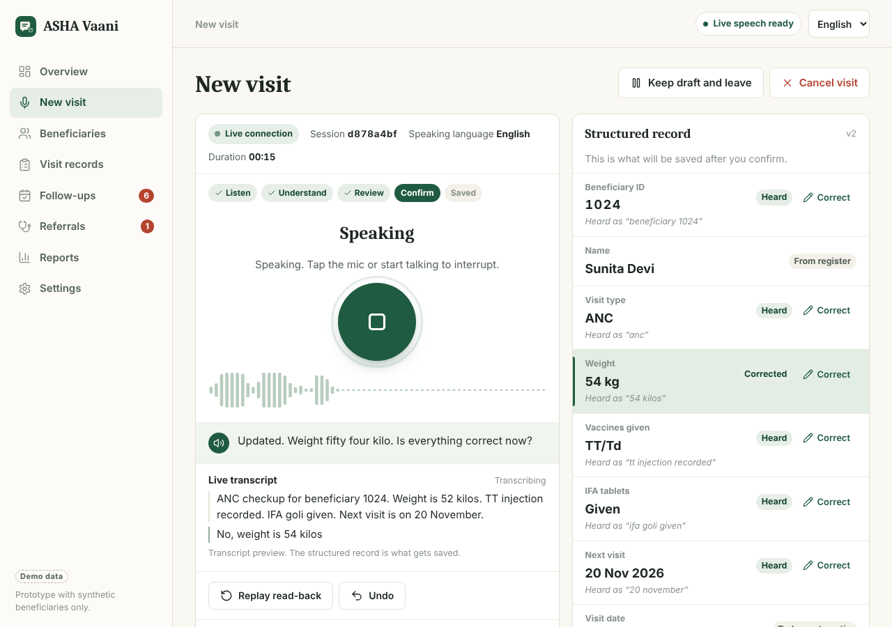
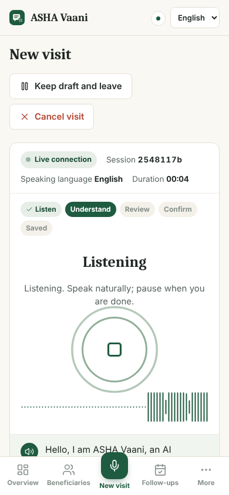
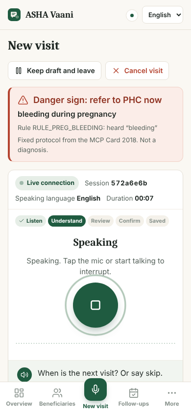
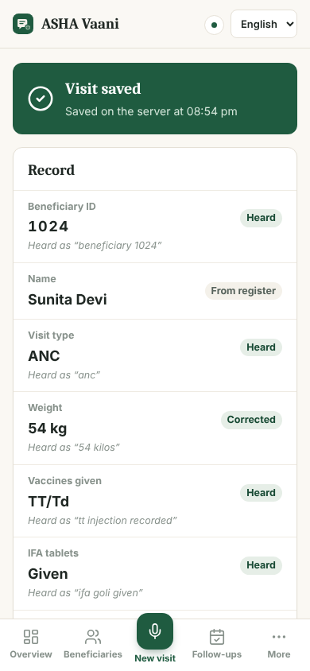
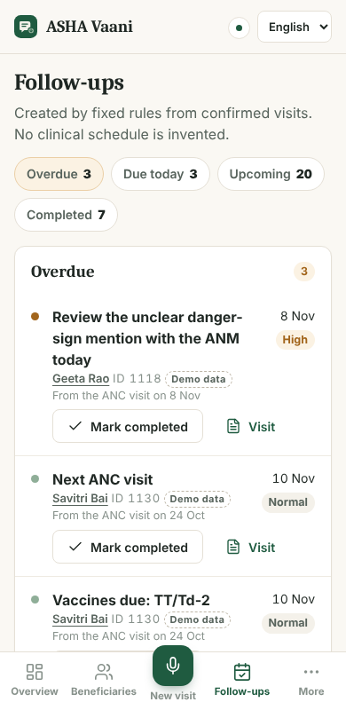
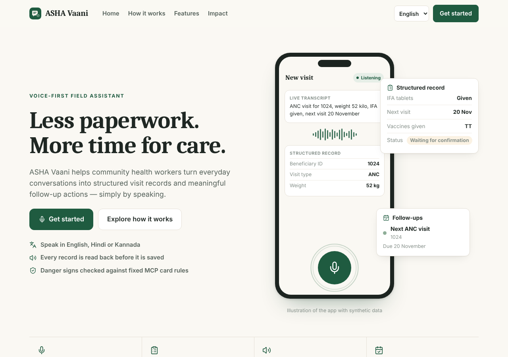
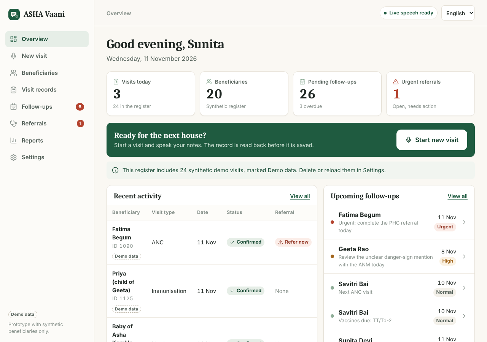
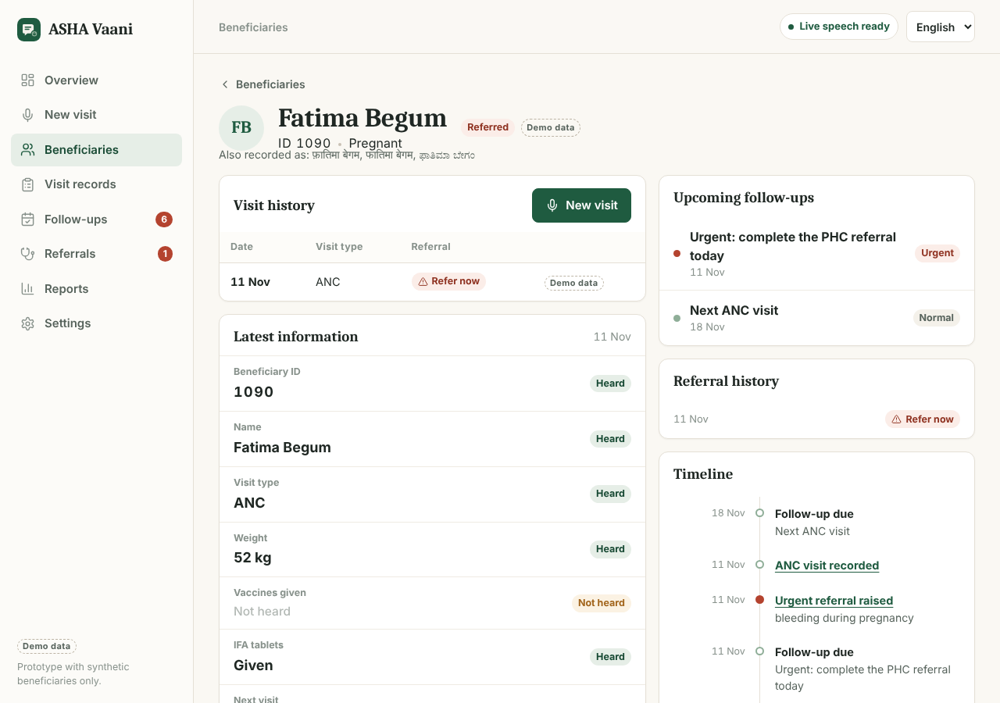
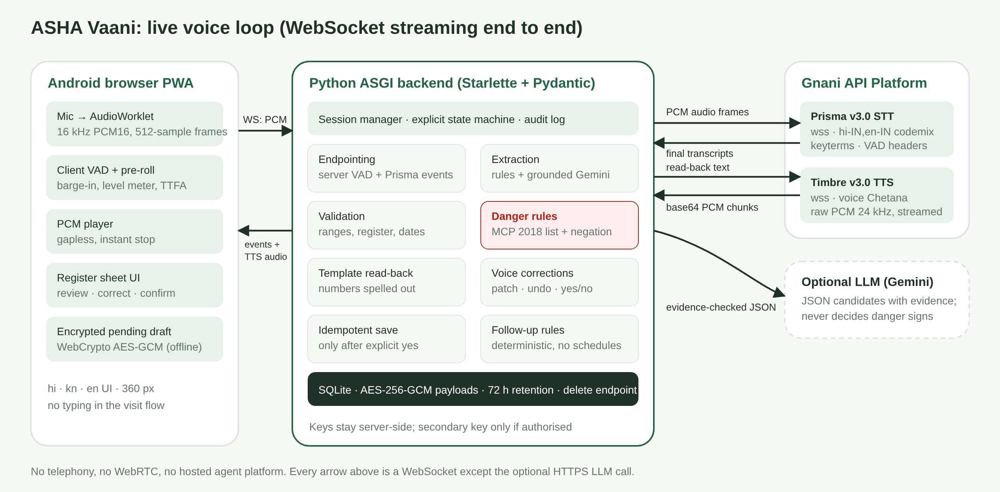
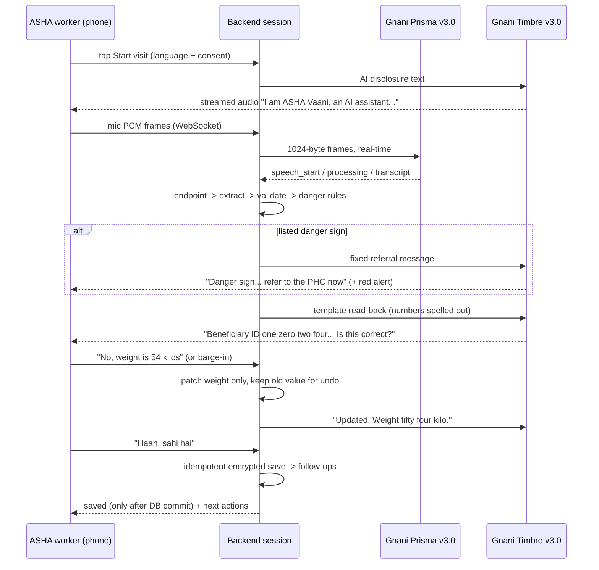

# ASHA Vaani — voice field register for ASHA workers

**Gnani Voice Hackathon 2026 · PS1 Healthcare.** An ASHA worker speaks her home-visit notes in Hindi, Kannada or English (code-mixed is fine). ASHA Vaani fills the visit form, reads it back, accepts corrections by voice, flags danger signs from the MCP card list with a fixed "refer to PHC now" message, and saves the record only after she says yes. Then it gives her the next actions. No typing.

> **Your voice. Every visit. Better follow-up.**
> Speak once. Hear what was understood. Fix it by voice. Confirm. Get the next action.



| Listening (phone) | Danger sign (phone) | Saved + follow-ups (phone) | Follow-up centre (phone) |
|---|---|---|---|
|  |  |  |  |

| Landing page | Overview | Beneficiary profile + timeline |
|---|---|---|
|  |  |  |

<sub>Captured in headless Chrome during the automated browser tests (real AudioWorklet mic capture from a WAV file, real backend and WebSocket). The Gnani endpoints in those tests were protocol-faithful fakes with scripted transcripts, because the build environment had no Gnani key, so "Live speech ready" there means "a key is configured", not that Gnani was called. Lists and reports show the labelled synthetic demo register. See [docs/integration-status.md](docs/integration-status.md).</sub>



---

## Contents
1. [Quick start](#1-quick-start) · 2. [Where the API keys go](#2-where-the-api-keys-go) · 3. [Gnani services used](#3-gnani-api-platform-services-used) · 4. [The app: screens, routes, demo data](#4-the-app-screens-routes-demo-data) · 5. [How it works](#5-how-it-works) · 6. [Danger-sign guideline (citation)](#6-danger-sign-list-and-guideline-citation) · 7. [Responsible AI](#7-responsible-ai-and-compliance) · 8. [Test on a phone](#8-test-on-a-phone-https) · 9. [Tests and evaluation](#9-tests-and-evaluation) · 10. [Project structure](#10-project-structure) · 11. [Known limitations](#11-known-limitations) · 12. [Troubleshooting](#12-troubleshooting)

## 1. Quick start

Requirements: **Python 3.10+**. Node 18+ is only needed if you change the frontend (a prebuilt `frontend/dist/` is included).

**Linux / macOS**
```bash
./start.sh
```
**Windows**
```bat
start.bat
```
Both scripts create a virtualenv, install `backend/requirements.txt`, create `backend/.env` with a fresh encryption key, and start the server on **http://localhost:8000**.

Manual equivalent:
```bash
python -m venv .venv && source .venv/bin/activate        # Windows: .venv\Scripts\activate
pip install -r backend/requirements.txt
python scripts/setup/generate_keys.py                    # creates backend/.env + ASHA_DATA_KEY
# put your Gnani key in backend/.env (see section 2)
cd backend && uvicorn app.main:app --host 0.0.0.0 --port 8000
```

**Gate 1 check (do this first, costs a few credits):** proves a real Timbre → Prisma round trip with your key.
```bash
python scripts/verification/gnani_smoke_test.py --lang hi
```
It saves `scripts/verification/out_timbre.wav` and prints what Prisma heard plus measured latencies.

## 2. Where the API keys go

All secrets live in **`backend/.env`** (git-ignored, never sent to the browser, never logged):

```ini
GNANI_API_KEY=<your-gnani-key>              # required for live speech (Prisma + Timbre)
GEMINI_API_KEY=<your-gemini-key>             # optional: LLM-assisted extraction
GEMINI_MODEL=gemini-3.5-flash-lite
ASHA_DATA_KEY=...                            # filled automatically by generate_keys.py
```

- **Speech must use Gnani.** The hackathon requires Prisma v3.0 (STT) and Timbre v3.0 (TTS), so a Gemini key cannot be used for speech-to-text or text-to-speech in the judged loop. Gemini is used only as the optional LLM (an "open choice" under the rules).
- Without `GEMINI_API_KEY` the app uses the deterministic rule-based extractor alone (which is what the tests and evaluation measure).
- `GNANI_API_KEY_SECONDARY` is used only if `GNANI_SECONDARY_AUTHORISED=true`. Set that only if organisers confirm teams may use more than one key. Keys are never rotated to get around limits.

## 3. Gnani API Platform services used

Verified against docs.gnani.ai in November 2026.

| Service | Endpoint | Configuration in ASHA Vaani |
|---|---|---|
| **Prisma v3.0** streaming STT | `wss://api.vachana.ai/stt/v3/stream` | header auth `x-api-key-id`; `model: prisma-v3.0`; `language_code: hi-IN,en-IN` / `kn-IN,en-IN` / `en-IN`; `format: codemix`; `x-sample-rate: 16000`; VAD headers (`x-vad-threshold 0.5`, `x-min-silence-ms 600`); `keyterms` = medical glossary (ANC, PNC, IFA goli, TT injection, Penta, MCP card …) as a JSON array. Audio is raw PCM s16le mono in **1,024-byte (512-sample, 32 ms) frames** sent at real-time cadence; `{"type":"commit"}` closes an utterance. |
| **Timbre v3.0** streaming TTS | `wss://api.vachana.ai/api/v1/tts` | header `X-API-Key-ID`; JSON request `{text, model: "timbre-v3.0", voice: "Chetana", language: hi-IN/kn-IN/en-IN, speed, audio_config: {sample_rate: 24000, encoding: "linear_pcm", container: "raw"}}`; `start` → base64 `audio` chunks → `complete`, forwarded to the phone as they arrive. |

Prisma v3.0 sends final transcripts only (no partials), so the app shows final segments as they arrive and never invents interim text. Numbers, IDs and dates are spelled out before synthesis, as the Timbre docs advise. Fixed prompts (disclosure, short questions) are cached after first synthesis to save credits and cut latency; read-backs containing beneficiary details are never cached to disk.

## 4. The app: screens, routes, demo data

Open **http://localhost:8000**. The landing page explains the product; **Get started** opens the app. The first time, a four-step onboarding runs once on that device: AI disclosure and what the assistant will never do, language (English is preselected; Hindi and Kannada are the other languages this build supports end to end), a microphone and speaker check, and the visit workflow (Speak, Review, Correct, Confirm, Save). There is no login: the prototype has a single worker and no accounts.

| Route | Screen | What it does |
|---|---|---|
| `/` | Landing | Product story, how it works, features, design goals (no invented statistics), privacy and prototype notice |
| `/onboarding` | Onboarding | Four steps, stored on the device; Settings can show it again |
| `/app` | Overview | Greeting, live counts from the register, recent activity, upcoming follow-ups, a kept draft to resume |
| `/app/new-visit` | Voice workspace | Speaking language + consent, then the live Gnani pipeline (details in section 5) |
| `/app/beneficiaries` | Beneficiaries | Search by ID or name, filter by category and recent activity |
| `/app/beneficiaries/:id` | Profile | Visit history, latest record with the phrase each field was heard as, follow-ups, referrals, timeline |
| `/app/visits` | Visit records | Newest first; filter by type, date, referral and status; CSV export of exactly the filtered list; print or save as PDF |
| `/app/visits/:id` | Record detail | Fields with confidence and spoken evidence, transcript, follow-ups, correction and confirmation history |
| `/app/follow-ups` | Follow-ups | Overdue, Due today, Upcoming, Completed; mark completed or reopen |
| `/app/referrals` | Referrals | Open and completed urgent referrals and ANM reviews with the matched sign, rule ID, heard phrase and guideline reference |
| `/app/reports` | Reports | Visits per day, visits by type, follow-up status and referral counts, computed on the server for 7, 30, 90 days or a custom range, each chart with a table view |
| `/app/settings` | Settings | App language and speaking language (separate), name, mic test, Timbre speaker test, barge-in, service status, measured latency, retention, reload or delete data |

**Voice workspace.** The left column shows the session (live or demo badge, session ID, speaking language, duration), the step strip (Listen, Understand, Review, Confirm, Saved), the current state in words (Ready, Connecting, Listening, Processing speech, Extracting details, Reviewing, Speaking, Waiting for confirmation, Correcting, Saving, Completed, Reconnecting, Offline with draft kept), the mic, a level meter drawn only from real microphone frames, what the assistant said, and the live Prisma transcript. The right column is the structured record that will be saved: each field shows its value, whether it was heard, needs a check, came from the register or was corrected, and the phrase it was heard as. Each field has a **Correct** button that tells her what to say and opens the mic; the change is still made by voice and read back. Controls appear only when they can work: Replay read-back, Undo, Skip question, Retry microphone, Reconnect, Confirm and save, Keep draft and leave, and a two-tap Cancel visit. The summary is shown only after the server's `saved` event.

**Demo data.** The server seeds a synthetic register on start-up: 20 beneficiaries and 24 visits (9 ANC, 5 PNC, 5 newborn, 5 immunisation) with follow-ups, two urgent referrals (one completed) and one ANM review, dated relative to today. Seeded records have `source = "seed"` and carry a **Demo data** label everywhere, including CSV exports. Seeding is idempotent.
```bash
python scripts/setup/seed_demo_data.py            # add any missing seeded visits
python scripts/setup/seed_demo_data.py --reset    # recreate them with today's dates (recorded visits are kept)
```
Set `ASHA_SEED_DEMO=0` to start with an empty register. Settings has **Reload demo data** and **Delete all records**.

**API added for these screens** (all read from the encrypted register; nothing is computed in the browser):
`GET /api/beneficiaries`, `GET /api/beneficiaries/{id}`, `GET /api/referrals?state=OPEN|CLOSED`, `GET /api/reports?from&to` (at most 366 days), `GET /api/visits?q&visit_type&referral&from&to&source`, `GET /api/visits/export.csv` (same filters), `GET /api/followups?status=PENDING|DONE|ALL`, `POST /api/demo-data/seed {"reset": bool}`.

**Design.** Light theme: ivory ground, forest green for actions, muted sage for secondary marks, charcoal type, warm grey hairlines, terracotta only for urgent referrals and amber only for pending or uncertain states. Serif headings over a sans body, line icons drawn on the Lucide grid (paths inline, no runtime dependency). Charts use one hue and always offer a table. Layouts were checked at 360, 390, 768 and 1280 px in English, Hindi and Kannada with no horizontal overflow and no console errors.

## 5. How it works



**Conversation states** (`backend/app/state_machine.py`): `IDLE → CONNECTING → LISTENING → TRANSCRIBING → EXTRACTING → VALIDATING → SAFETY_CHECK → (ALERTING) → ASKING | READBACK → CONFIRMING ⇄ CORRECTING → SAVING → SUMMARY`, plus `RECOVERY`, `RECONNECTING`, `PENDING`. Invalid transitions are rejected and reported.

**Speech-layer depth**
- **Streaming end to end:** browser AudioWorklet → WebSocket → Prisma; Timbre chunks → WebSocket → gapless playback.
- **Endpointing:** Prisma's VAD segments speech; the backend ends a *turn* after the last transcript plus 1.1 s of silence for dictation (so pauses in IDs and numbers are not cut off) or 0.7 s for short answers. The worker can also tap the mic to finish.
- **Barge-in:** a client-side VAD watches the mic while the agent speaks. When she talks, playback stops at once, the Timbre stream is dropped, and the last 320 ms of audio (pre-roll) is sent to Prisma so her first words are kept. Tapping the mic also interrupts. This can be turned off in Settings.
- **Code-mix:** Prisma runs with two language codes plus medical keyterms. The parser reads Devanagari, Kannada and romanised forms, Hindi number words 0–100, Kannada number words with sandhi (ಐವತ್ತೆರಡು), English numbers, decimals ("do point aath"), Hindi fractions (ढाई, साढ़े तीन), digit-by-digit IDs ("एक शून्य दो चार"), grams→kg, and relative dates (kal, parso, ನಾಳೆ, अगले सोमवार, "15 din baad").
- **Noise:** browser echo cancellation, noise suppression and AGC, an adaptive server VAD noise floor, Prisma VAD threshold configuration, and read-back plus voice correction as the safety net.
- **Latency:** an optional instant cached acknowledgement ("Okay, one moment") plays while the LLM runs. Every stage is timed (see Settings → measured latency, or `GET /api/metrics`).

**Extraction contract:** only stated facts are extracted; missing fields stay empty and are asked for one at a time (ID and visit type are required; weight and next visit are asked once and can be skipped). Rule extraction always runs. Gemini, if configured, may add a candidate only when it quotes evidence that literally appears in the transcript; any disagreement marks the field "Please confirm". Implausible values (for example a 28 kg newborn) are kept but flagged and read slowly.

## 6. Danger-sign list and guideline citation

Danger signs come **only** from these official Government of India documents:

1. **Mother and Child Protection Card (MCP Card), 2018 version.** Ministry of Health & Family Welfare and Ministry of Women & Child Development. https://nhm.gov.in/New_Updates_2018/NHM_Components/Immunization/Guildelines_for_immunization/MCP_Card_English_version.pdf — sections "danger signs during pregnancy", "in case of emergency after delivery", "newborn danger signs", "care during illness".
2. **Guidebook for Mother-Child Protection Card 2018 for ANM | ASHA | AWW** (MoHFW & MoWCD). Section 6 *Emergency Care and Preparation for Delivery*, pp. 14–15 (pregnancy); Section 8 *Care of Newborn and HBYC*, p. 19 (newborn). https://iec.unicef.in/public/uploads/documents/222758bf054a1620a8bc64fe41f4ace2.pdf

Implemented signs: bleeding in pregnancy · excessive bleeding after delivery · high fever (pregnancy / within a month of delivery) · severe anaemia · severe headache or blurred vision · fits / convulsions · swelling all over the body · water bag burst · reduced foetal movement · labour pain over 12 hours · newborn: not feeding / weak suck, unable to cry, fast or difficult breathing, yellow palms/soles/skin, fever or cold to touch, blood in stools, lethargic / unconscious · child: high fever, loose motions not stopping. The full table with phrases, negation rules and page references is in [docs/danger-sign-guideline.md](docs/danger-sign-guideline.md).

Engine: deterministic regex lexicon (Hindi, Kannada, English, romanised) → negation window ("bleeding nahi hai", "ರಕ್ತಸ್ರಾವ ಇಲ್ಲ") with "not stopping" handled ("ruk nahi rahi" stays positive) → uncertainty and past/other-person cues ("pata nahi", "pichhli pregnancy") become a yes/no question rather than being dropped → visit-type applicability → fixed referral text. A positive sign is spoken **immediately**, before the read-back. No LLM output can raise or clear a flag. If the worker later contradicts a flagged sign, it becomes "ANM review", never silently cleared.

> Prototype for a hackathon. Phrase lists and referral wording were written by the build team and still need review by a health professional and native speakers. Not clinically validated.

## 7. Responsible AI and compliance

| Baseline rule | How it is met |
|---|---|
| AI disclosure in the first turn, in the user's language | The first agent utterance (Timbre) says "I am ASHA Vaani, an AI assistant, not a person" in hi/kn/en; the consent screen says the same in text. |
| Synthetic or consented data only | 18 fictional beneficiaries (`backend/app/storage/seed.py`); consent checkbox required before a session can be created (`POST /api/sessions` rejects without it). |
| Transcripts encrypted at rest, deleted after judging | AES-256-GCM payloads (key outside the DB); 72 h automatic purge; `POST /api/demo-data/delete`, the Settings button, or `python scripts/setup/delete_demo_data.py --yes`. |
| No diagnosis, treatment or dosage advice | Only fixed templates are spoken. Requests like "kaunsi dawai du?" get a fixed refusal. No LLM text is ever spoken. |
| Secrets out of the repo | `backend/.env` is git-ignored; `scripts/verification/check_secrets.py` scans before release. |
| No voice cloning | A stock Timbre v3.0 catalog voice (Chetana). |
| Honest states | "Saved" only after the DB commit; `tts_unavailable` shown when audio fails; offline drafts are labelled "Pending, not saved"; demo mode is bannered and never calls Gnani. |

More detail: [docs/privacy-and-data-policy.md](docs/privacy-and-data-policy.md).

## 8. Test on a phone (HTTPS)

Mobile browsers allow the microphone only on **HTTPS** (or localhost). Options:
- **Tunnel (fastest):** `cloudflared tunnel --url http://localhost:8000` (or `ngrok http 8000`), then open the https URL on the Android phone. Add that URL to `ASHA_CORS_ORIGINS` in `backend/.env`.
- **Host:** the `Dockerfile` runs anywhere that provides HTTPS (Render, Railway, Fly.io, a VM behind Caddy). Set `GNANI_API_KEY`, `ASHA_DATA_KEY`, `ASHA_ENV=prod` and `ASHA_CORS_ORIGINS` as environment variables.

On the phone: Get started → finish onboarding once → **New visit** → pick the speaking language → tick consent → **Start live visit** → allow the microphone → speak after the disclosure ends.

## 9. Tests and evaluation

```bash
pip install -r backend/requirements-dev.txt
cd backend && python -m pytest tests -q          # 175 tests (unit, full WebSocket visit flows, demo data and new APIs)
cd .. && python evaluation/run_eval.py           # 65 scripted utterances -> evaluation/results.md
cd frontend && npm install && npm test           # build + 6 frontend tests (AudioWorklet resampler, VAD, i18n…)
python scripts/verification/check_secrets.py     # no keys / .env / databases in the tree
```
Optional, spends credits: `python evaluation/run_eval.py --live-loopback --limit 10 --noise-snr 10` (Timbre voice + synthetic street noise → Prisma → pipeline).

Results and exactly what was and was not tested: [docs/test-results.md](docs/test-results.md) and [docs/integration-status.md](docs/integration-status.md).

## 10. Project structure

```text
backend/app/
  main.py                 ASGI app: REST API, visit WebSocket, PWA static hosting, security headers
  config.py               env configuration (no secrets in responses)
  session_manager.py      per-visit orchestration: listening, endpointing, turns, speech queue, save
  state_machine.py        explicit states + allowed transitions
  websocket/events.py     validated client events (Pydantic) + binary audio framing
  speech/gnani_stt.py     Prisma v3.0 streaming adapter      speech/gnani_tts.py  Timbre v3.0 adapter + prompt cache
  speech/transport.py     websockets client wrapper          speech/audio_utils.py framing, VAD, WAV
  services/extraction.py  rule extractor + grounded LLM merge   services/llm_gemini.py optional Gemini
  services/normalise.py   Indic-safe tokenizer, glossary, keyterms
  services/numbers.py     hi/kn/en spoken numbers (parse + speak)   services/dates.py relative/absolute dates
  services/validation.py  ranges, register, required fields  services/corrections.py yes/no/undo/patch intents
  services/danger_rules.py  MCP 2018 deterministic engine     services/followups.py deterministic next actions
  services/readback.py    template read-back                  services/credential_manager.py key policy + usage
  storage/db.py crypto.py seed.py   SQLite, AES-GCM, synthetic register
  storage/demo_seed.py    idempotent synthetic visits, follow-ups and referrals (source=seed)
  templates/prompts.json  every sentence the agent can say (hi/kn/en)
backend/tests/            175 pytest tests incl. protocol-faithful Gnani fakes + in-process ASGI driver
frontend/src/             dependency-free TypeScript PWA
  main.ts router.ts       history-API routes, persistent app shell, onboarding gate
  pages/                  landing, onboarding, overview, workspace (voice), beneficiaries, visits,
                          followups, referrals, reports, settings
  components/             shell, record sheet, charts, states (loading/empty/error), formatting
  audio/ services/        AudioWorklet capture, VAD, PCM player, visit socket, encrypted drafts
  i18n.ts                 every UI string in English (default), Hindi and Kannada
frontend/public/          index.html, styles, service worker, AudioWorklet, manifest, icons
frontend/dist/            prebuilt app served by the backend
evaluation/               utterances.csv, expected_outputs.json, run_eval.py, results.md
docs/                     architecture, guideline, privacy, demo script, traceability, test results, status
submission/               pitch deck (PPTX), demo-video storyboard, submission checklist
scripts/                  setup (keys, seed demo data, deletion), verification (Gnani smoke test, secret scan)
```

**Why Starlette and not FastAPI, and why no React?** Both were the planned stack, but the build environment could not install packages. The backend uses Starlette directly (FastAPI is built on it; the routes and WebSocket API are the same) with Pydantic validation. The frontend is strict TypeScript compiled by `tsc` with no runtime dependencies (no framework, no icon or chart library; quick on low-end Android). This let every part be executed and tested before delivery rather than shipped unrun.

## 11. Known limitations
- **Live Gnani calls were not executed during the build** (no key or network in the build environment). Adapters follow the current docs and are tested against protocol fakes; run the Gate 1 smoke test before anything else.
- Prisma `codemix` output formatting (script of Indic words, numbers as words or digits) is only partly documented. The parser handles both, but check real output and try `GNANI_STT_FORMAT=transcribe` if numbers come back oddly.
- The evaluation set (65 utterances) was written by the build team alongside the rules, so its 100% score is a regression check, not a measure of accuracy on unseen speech. Add held-out utterances from teammates before judging.
- Danger phrase lists and all Hindi/Kannada wording (agent prompts and UI strings) need review by a health professional and native speakers.
- The landing page's product imagery is the app's own UI drawn in HTML with synthetic data and is labelled as an illustration; the impact section states design goals, not measured outcomes.
- Single-worker prototype: session tokens protect live sessions, but there is no login. Production would need authentication and role-based access.
- Latency numbers in the docs come from the sandbox with simulated Gnani; real numbers appear in Settings once live sessions run.

## 12. Troubleshooting
| Symptom | Fix |
|---|---|
| "Live speech is not configured" | `GNANI_API_KEY` is empty in `backend/.env`; restart the server after editing. |
| Mic button shows the permission message | Allow the microphone for the site; on phones use HTTPS (section 7). |
| Status "Offline, draft kept" or "Pending sync" | Speech or network was lost; the draft is kept (encrypted on the device). Tap Reconnect, or Resume on Overview or Visit records, and confirm again. |
| Onboarding keeps appearing | The browser is clearing site storage (private mode). Onboarding state, name and languages are stored on the device only. |
| `stt:auth` / HTTP 401 | Wrong Gnani key. `stt:quota` → credits exhausted (a secondary key is used only if authorised). |
| Numbers misheard | Speak IDs digit by digit; correct by voice ("ID galat hai, 1025 hai"); try `GNANI_STT_FORMAT=transcribe`. |
| Agent interrupts itself | Echo is triggering barge-in: use earphones or turn off "Interrupt the assistant by speaking" in Settings. |
| `ModuleNotFoundError: websockets` | `pip install -r backend/requirements.txt` (uvicorn[standard] + websockets are required for live audio). |
