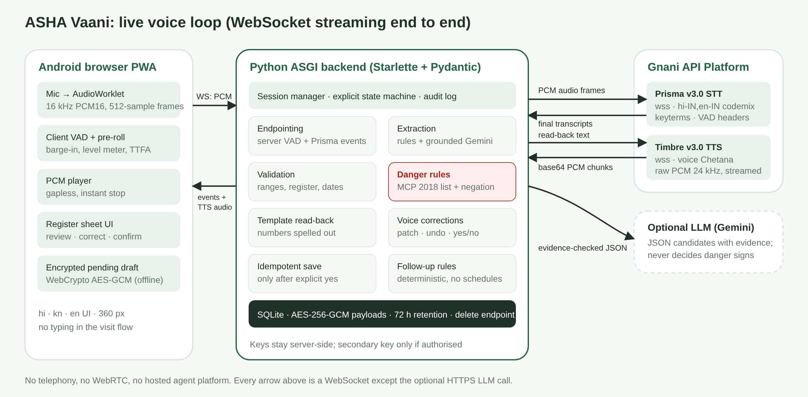
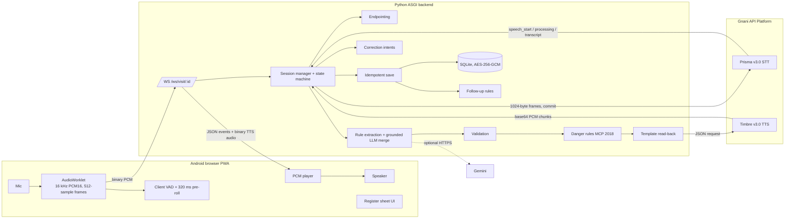

# Architecture

## Components and responsibilities

| Component | File | Responsibility | Must not |
|---|---|---|---|
| PWA audio client | `frontend/src/audio/*`, `public/audio/pcm-capture-worklet.js` | capture, resample, frame, VAD, barge-in, gapless playback | expose keys; claim saved |
| Visit page | `frontend/src/pages/visit.ts` | state-driven UI, register sheet, alert, summary, pending draft | show "Saved" before the server event |
| WS endpoint | `backend/app/main.py` (`visit_ws`) | token check, size limits, event validation, routing | mix sessions |
| Session | `backend/app/session_manager.py` | listening, endpointing, turns, speech queue, cancel, save | invent transcript content |
| Prisma adapter | `backend/app/speech/gnani_stt.py` | headers, 1024-byte framing, pacing (≤ 2× real time), commit, events, quota detection | send unbounded buffers |
| Timbre adapter | `backend/app/speech/gnani_tts.py` | one request at a time, chunk decode, cancel by dropping the socket, fixed-prompt cache | cache personal read-backs to disk |
| Extraction | `services/extraction.py`, `llm_gemini.py` | schema candidates with evidence | make clinical decisions |
| Validation | `services/validation.py` | ranges, register, dates, required fields | accept implausible values silently |
| Danger engine | `services/danger_rules.py` | fixed list, negation, uncertainty | diagnose or advise |
| Read-back | `services/readback.py`, `templates/prompts.json` | fixed templates, numbers spelled out | generate free text |
| Store | `storage/db.py`, `crypto.py` | encrypted save after confirmation, idempotency, retention | store raw audio or real data |

## Application WebSocket protocol

**Client → server**
- Binary: raw PCM s16le mono 16 kHz (any length; the backend re-chunks to 1,024 bytes). Audio only.
- JSON (validated by `websocket/events.py`, unknown types rejected, 64 KB limit): `hello{resume}`, `start_listening{reason}`, `stop_listening`, `barge_in`, `cancel_tts`, `playback_started{utterance_id}`, `playback_ended{utterance_id, interrupted}`, `client_metric{name, value_ms}`, `action{confirm|undo|repeat|skip|retry_save|…}`, `demo_utterance{text}` (accepted **only** in demo mode), `ping`.

**Server → client** (every event has `type, session_id, seq, ts, mode`)
- `session`, `state{state, prev, awaiting}`, `listen{on, awaiting, reason, endpoint_ms}`, `stt_status`, `transcript{text, is_final, latency_ms}`, `turn_transcript`, `draft{record, meta, danger, referral_status, changed_fields, issues, can_undo, can_save, draft_version}`, `ask`, `readback`, `agent_say{utterance_id, text, kind, audio, sample_rate}`, `tts_start`, `tts_end`, `tts_unavailable`, `tts_cancel`, `danger_alert{signs, message, referral_status}`, `saved{visit_id, saved_at, record, followups}`, `save_failed`, `recovery{layer, code, message}`, `error{code, message, recoverable}`.
- Binary: `[0x01][uint32 LE utterance_id][PCM16 mono @ 24 kHz]`.

## REST API
| Method | Path | Purpose |
|---|---|---|
| GET | `/api/health` | readiness (no secrets) |
| GET | `/api/config` | non-secret configuration (models, voice, languages, retention) |
| GET | `/api/session/status` | Gnani configured?, account aliases and exhaustion, LLM status, usage estimates |
| POST | `/api/sessions` | `{language, consent: true, mode}` → session id + token (consent is required) |
| GET | `/api/sessions/{id}` | session snapshot (header `X-Session-Token`) |
| POST | `/api/visits/confirm` | confirm and save (idempotent, token, optional `draft_version`) |
| GET | `/api/visits`, `/api/visits/{id}` | synthetic visit list / detail with follow-ups and audit trail |
| GET/POST | `/api/followups`, `/api/followups/{id}/status` | pending actions / mark done |
| GET | `/api/dashboard`, `/api/metrics`, `/api/register`, `/api/danger-signs` | home stats, latency median/p95, synthetic register, rule catalogue + citation |
| GET | `/api/diagnostics/tts?lang=hi` | Timbre playback test (WAV) |
| POST | `/api/demo-data/delete` | `{confirm: "DELETE"}` deletes all demo data |

## Data model (SQLite)
| Table | Plaintext columns (indexing) | Encrypted |
|---|---|---|
| `beneficiaries` | synthetic id, name, aliases (all fictional) | — |
| `visits` | id, session_id, idempotency_key (unique), beneficiary_id, visit_type, visit_date, referral_status, source live/demo | full record incl. transcript, evidence, danger details |
| `followups` | visit_id, action_type, due_date, status, priority | title text |
| `sessions` | id, token hash, language, mode, state, expiry | draft (for refresh / restart recovery) |
| `session_events` | event type, field, reason code, time (no personal data) | — |
| `service_usage` | account alias, service, estimated units | — (never the key) |
| `metrics` | name, value_ms | — |

## Follow-up rules (deterministic, `services/followups.py`)
R1 REFER_NOW → URGENT "complete the PHC referral today" · R2 REVIEW_REQUIRED → HIGH "review with ANM today" · R3 next visit date → NORMAL on that date · R4 vaccines due → NORMAL, dated only if a next visit date was spoken · R5 no next date → "schedule next visit" · R6 no weight → LOW "record weight next visit". No vaccination schedule or interval is ever invented.

## Recovery layers
1. **Retry / reconnect:** WebSocket backoff 0.5 → 8 s with jitter (6 attempts); Prisma connect retried 3× with backoff; a dropped Prisma stream is reopened once while listening.
2. **Authorised secondary key:** used only if `GNANI_SECONDARY_AUTHORISED=true`; quota or credit errors mark an account exhausted.
3. **Pending draft:** server keeps the encrypted session draft (survives refresh and backend restart); the phone keeps a WebCrypto-encrypted copy when offline. Both are labelled "Pending, not saved", and resuming always re-asks for confirmation.
4. **Demo mode:** a separate, bannered mode with sample notes; it never calls Gnani, never plays audio, and saved records are tagged `source = demo`.
